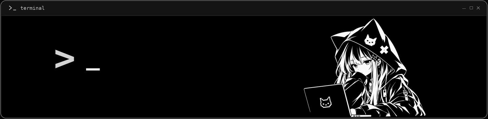
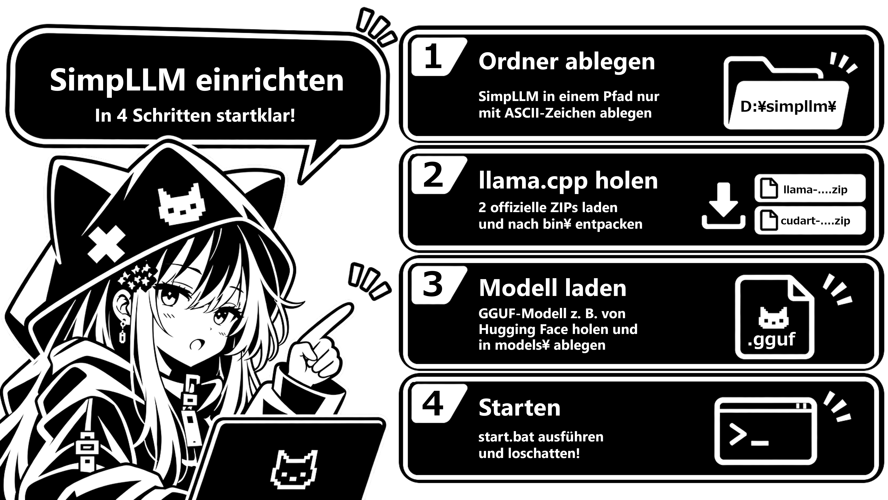

<div align="center">



<p>
  <a href="README.md">日本語</a> ·
  <a href="README.en.md">English</a> ·
  <b>Deutsch</b> ·
  <a href="README.zh-CN.md">简体中文</a> ·
  <a href="README.ko.md">한국어</a>
</p>


<p>
  
  
  
  
  
</p>

<p>
  <a href="https://github.com/Retro-Maid/SimpLLM/releases"></a>
  <a href="https://github.com/Retro-Maid/SimpLLM/commits"></a>
  <a href="LICENSE"></a>
  <a href="https://github.com/Retro-Maid/SimpLLM/releases"></a>
  <a href="https://github.com/Retro-Maid/SimpLLM/stargazers"></a>
</p>

<p>
  <a href="#quickstart">Schnellstart</a> ・
  <a href="#features">Was es kann</a> ・
  <a href="#compare">Vergleich</a> ・
  <a href="#requirements">Voraussetzungen</a> ・
  <a href="#troubleshooting">Wenn es nicht läuft</a>
</p>

</div>

<div align="center">

</div>

<a id="quickstart"></a>

## Schnellstart (schneller als eine Tasse Instantnudeln)

1. **SimpLLM holen** — die zip von den [Releases](https://github.com/Retro-Maid/SimpLLM/releases/latest) herunterladen und entpacken. Jeder Ordner mit Schreibrechten passt, zum Beispiel `C:\simpllm`
2. **llama.cpp dazulegen** — diese beiden Dateien von den [offiziellen Releases](https://github.com/ggml-org/llama.cpp/releases) laden und ihren Inhalt direkt nach `bin\` legen (den Inhalt, nicht den Ordner)

   ```
   llama-<Version>-bin-win-cuda-12.4-x64.zip
   cudart-llama-bin-win-cuda-12.4-x64.zip
   ```

3. **Modell ablegen** — eine beliebige `.gguf` nach `models\` legen
4. **Starten** — Doppelklick auf `start.bat`

Sobald das Fenster offen ist, kann man loslegen. Das geht vermutlich schneller als die drei Minuten, die die Nudeln ziehen müssen (der Download des Modells zählt nicht mit).

<a id="features"></a>

## Was es kann

Ordner herunterladen. llama.cpp herunterladen. Ein Modell nach Wahl dazulegen. Doppelklick auf `start.bat`, fertig.

- **Keine Installation** — es gibt kein Installationsprogramm, und in die Registry wird nichts geschrieben. Wer es nicht mehr braucht, löscht den Ordner.
- **Keine Zusatzsoftware** — kein Python, kein Node.js, kein Docker. Es läuft mit der PowerShell, die Windows mitbringt, und mit Chrome oder Edge.
- **Etwa 1 MB** — llama.cpp und die Modelle besorgt man selbst. SimpLLM allein ist etwa 1 MB groß.
- **Eine HTML-Seite** — kein Framework, keine externen Bibliotheken.
- **Startet schnell** — zuerst öffnet sich das Fenster, das Modell lädt im Hintergrund. Auf dem Entwicklungs-PC vergehen vom Start bis kurz vor dem Öffnen des Fensters etwa 0,45 Sekunden.
- **Zu heißt aus** — wer das Fenster schließt, beendet auch den Server. Im Hintergrund bleibt nichts zurück.
- **Bleibt leicht, auch mit vielen Chats** — mehr Chats machen es kaum langsamer. Zuerst wird nur die Liste gelesen, der Text eines Chats erst beim Öffnen.

Die Funktionen in einer Tabelle:

| | |
|---|---|
| Chat | Neu generieren, bearbeiten, abzweigen, Modell wechseln, Systemprompts speichern |
| Anhänge | Textdateien, PDFs, Bilder (Bilder nur mit einem Modell, das eine `mmproj` hat) |
| Bilder generieren und bearbeiten | Verfügbar, sobald stable-diffusion.cpp und ein Bildmodell vorhanden sind |
| Verlauf | Chats, Bilder und Einstellungen werden automatisch gespeichert. Ordner, Anheften, Suche, Export als JSON oder Markdown |
| Erweiterte Funktionen | Lokale Tools, Projekte und btw für eine kurze Zwischenfrage, ohne den Hauptchat zu unterbrechen |
| Anzeigesprachen | Japanisch, Englisch, vereinfachtes Chinesisch, traditionelles Chinesisch, Koreanisch, Deutsch |
| Privatsphäre | Die Chats verlassen den PC nicht. Auch die Seite spricht nicht mit der Außenwelt |

<a id="compare"></a>

## Im Vergleich mit anderen Chat-Clients (leicht! einfach! ohne Installation!)

Verglichen wurde die Windows-Version jeder Anwendung, Stand November 2026 (LM Studio 0.4.28, Ollama 0.40.17).

| | SimpLLM | LM Studio | Ollama |
|---|---|---|---|
| Einrichtung | Ordner ablegen | Installationsprogramm | Installationsprogramm |
| Was zusätzlich nötig ist | llama.cpp (von den offiziellen Releases nach `bin\`) | Nichts | Nichts |
| Größe der Anwendung | Etwa 1 MB | Komplette Anwendung | Komplette Anwendung |
| Betriebssysteme | Nur Windows | Windows, macOS, Linux | Windows, macOS (Linux nur per Befehlszeile) |
| Modelle beschaffen | Selbst laden und ablegen | In der Anwendung auf Hugging Face suchen und laden | In der Anwendung auswählen und laden |
| Vorhandene GGUF-Dateien | Ablegen, dann stehen sie in der Liste | Per Befehl importieren (`lms import`) | Modelfile schreiben und importieren |
| Neu generieren, abzweigen, weiterschreiben | Ja | Ja | Nein |
| Systemprompt und Sampling-Einstellungen | In der Oberfläche | In der Oberfläche | Nicht in der Oberfläche |
| Ladeeinstellungen (Typ des KV-Caches und mehr) | In der Oberfläche | In der Oberfläche | Nur die Kontextlänge |
| Chats durchsuchen, Ordner, Export | Ja (JSON, Markdown) | Ja (PDF, Markdown, Text) | Nur umbenennen und löschen |
| Dokumente anhängen | Text, PDF | Text, PDF, docx (RAG für lange Dokumente) | Text, PDF, docx und mehr |
| Tools | Eingebaut (Datum und Uhrzeit, Rechner, Suche in alten Chats) | Externe Tools über MCP anbinden | Websuche (Konto nötig) |
| Bilder generieren und bearbeiten | Ja | Nein | Nein |
| Anzeigesprachen | 6 | Viele (auch Japanisch) | Nur Englisch |
| Verbindungen nach außen | Keine (die Einstellungen der Seite und des Browsers lassen nichts nach außen) | Update-Prüfung beim Start, Modellsuche und Downloads | Regelmäßige Update-Prüfung, Cloud-Funktionen |
| Quellcode | Offen (MIT) | Nicht offen (auch beruflich kostenlos) | Offen (MIT) |

Gedacht ist SimpLLM für alle, die unter Windows ihre vorhandenen Modelle sofort laufen lassen wollen, ohne etwas zu installieren und ohne jede Verbindung nach außen. Auch Bilder entstehen im selben Fenster. Wer macOS oder Linux nutzt, Modelle in der Anwendung suchen oder externe Tools über MCP anbinden möchte, ist mit LM Studio besser bedient. Wer einfach nur möglichst leicht anfangen will, nimmt Ollama.

<a id="requirements"></a>

## Voraussetzungen

| | |
|---|---|
| Betriebssystem | Windows 10 (ab 1809) oder Windows 11. Unter macOS und Linux läuft es nicht |
| Browser | Chrome oder Edge. Edge ist bei Windows schon dabei |
| GPU | NVIDIA empfohlen |
| Speicher | RAM und VRAM zusammen sollten größer sein als die Modelldatei. Reicht es nicht, wird der Grund beim Start angezeigt |

Für llama.cpp diese beiden Dateien von den [offiziellen Releases](https://github.com/ggml-org/llama.cpp/releases) laden und nach `bin\` legen. Getestet wurde mit der Version b11669.

```
llama-<Version>-bin-win-cuda-12.4-x64.zip
cudart-llama-bin-win-cuda-12.4-x64.zip
```

Manches ist nicht ausprobiert.

- Ein PC ohne NVIDIA-GPU. Es sollte auf der CPU laufen, nur langsamer. Auf dem Entwicklungs-PC wurde es mit entferntem CUDA geprüft, weiter nicht
- GPUs von AMD und Intel. Die CUDA-Version nutzt sie nicht. Mit der Vulkan-Version (`llama-<Version>-bin-win-vulkan-x64.zip`) in `bin\` könnte es gehen

Die Anzeigesprache richtet sich zunächst nach der Sprache von Windows. Ändern lässt sie sich in den Einstellungen unter „Allgemein“.

<a id="troubleshooting"></a>

## Wenn es nicht läuft

Wenn es nicht startet oder ein Modell nicht laden kann, steht der Grund im Fenster oder in einem Hinweisfenster. Das zuerst lesen.

<details>
<summary><b>Es startet nicht oder das Modell lädt nicht</b></summary>

- Den Inhalt der zip direkt nach `bin\` legen, nicht als Ordner. Beide zips werden gebraucht
- Zu wenig Speicher? In den Einstellungen unter „Startoptionen“ die Kontextlänge verkleinern (zum Beispiel 8192). Ein kleineres Modell hilft auch
- Mit einem alten NVIDIA-Treiber geht es nicht. Bitte aktualisieren
- Die Modelldatei ist abgeschnitten oder beschädigt → neu herunterladen
- Eine neue Art von Modell kann ein altes llama.cpp nicht lesen. Den Inhalt von `bin\` durch eine neuere Version ersetzen

</details>

<details>
<summary><b>Nach einer geänderten Einstellung geht nichts mehr</b></summary>

In den Einstellungen unter „Startoptionen“ auf „Zurücksetzen“ drücken. Eine Einstellung, mit der der Server nicht mehr startet, wird schon beim Übernehmen automatisch zurückgenommen.

</details>

<details>
<summary><b>Bilder lassen sich nicht anhängen</b></summary>

- „Dieses Modell unterstützt keine Bildeingabe“ → die passende `mmproj*.gguf` in denselben Ordner wie das Modell legen
- „Die Bildeingabe im Chat ist aus“ → in den Einstellungen unter „Startoptionen“ die „Bildeingabe im Chat“ einschalten

</details>

<details>
<summary><b>Die Generierung ist langsam</b></summary>

Ohne GPU läuft es auf der CPU, und das ist nun einmal langsam. Mit GPU lässt es sich unter „Startoptionen“ bei „Erweitert“ einstellen.

</details>

<details>
<summary><b>Sonstiges</b></summary>

„Weder Chrome noch Edge wurde gefunden“. Ein Chromium-Browser an einem anderen Ort lässt sich angeben (Brave geht auch).

```
start.bat -Browser "<Pfad der ausführbaren Datei>"
```

Port 8080 ist belegt. Wurde keine Nummer vorgegeben, nimmt es einfach eine freie.

Es wird gar kein Grund angezeigt. Dann lässt sich die Ausgabe des Servers direkt ansehen.

```
start.bat -ShowServerLog
```

</details>

## Einstellungen

Zu öffnen über „Einstellungen“ unten links.

| Bereich | Inhalt |
|---|---|
| Allgemein | Senden mit der Eingabetaste, erweiterte Funktionen anzeigen, Anzeigesprache |
| Systemprompt | Anweisungen für den aktuellen Chat und gespeicherte, oft genutzte Anweisungen |
| Modelle | Der Modellordner, die Liste der gefundenen Modelle, Einstellungen je Modell |
| Startoptionen | Bildeingabe im Chat, Kontextlänge, Geschwindigkeit |
| Generierung | Temperatur und die übrigen Generierungsparameter |
| Bilder | Zustand und Einstellungen für das Generieren und Bearbeiten von Bildern |
| Tastenkürzel | Die Liste der Tastenkürzel. `Strg+/` öffnet sie ebenfalls |
| Daten | Importieren, exportieren, alles löschen |

Ein paar Anmerkungen.

- Tools, btw, Projekte, Mehrfachauswahl und die Tokenzahl bleiben verborgen, bis „Erweiterte Funktionen anzeigen“ eingeschaltet ist. Nur die Kontextnutzung erscheint von selbst, wenn die Grenze näher rückt
- Eine leere Startoption bedeutet den Standard von llama.cpp. Die meisten PCs laufen damit. Die Werte stehen in `.run\launch.json`. Was als Argument übergeben wird, etwa `start.bat -Context 8192`, hat Vorrang
- Auch leere Generierungsparameter bedeuten automatisch: bei Qwen-Modellen die offiziell empfohlenen Werte, sonst der Standard von llama.cpp
- Die Schaltfläche „Bild“ erscheint im Eingabefeld erst, wenn eine Bild-Engine und ein Modell vorhanden sind

## Aktualisieren und Entfernen

Zum Aktualisieren SimpLLM beenden und die neuen Dateien über den bisherigen Ordner kopieren. Folgendes gehört nicht zu einer neuen Version und bleibt deshalb erhalten.

- `history\` … Chats, Bilder, Einstellungen
- `models\` … die eigenen Modelle
- `bin\` … llama.cpp
- `.run\` … Startoptionen und die im Fenster geänderten Modelleinstellungen

Für einen Umzug in einen anderen Ordner `history\`, `models\`, `bin\` und aus `.run\` die Dateien `launch.json`, `model-dir` und `model-settings.json` mitnehmen.

Soll nur llama.cpp neu werden, den Inhalt von `bin\` austauschen.

Zum Entfernen beenden und den Ordner löschen. Nur die Verknüpfung auf dem Desktop (simpllm) muss von Hand weg. Sonst wird nirgends etwas geschrieben.

## Lizenz

[MIT](LICENSE). Privat oder beruflich nutzen, ändern, weitergeben. Nur der Urheberrechtshinweis und der Lizenztext müssen erhalten bleiben.
