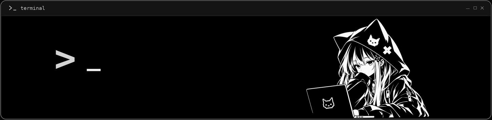
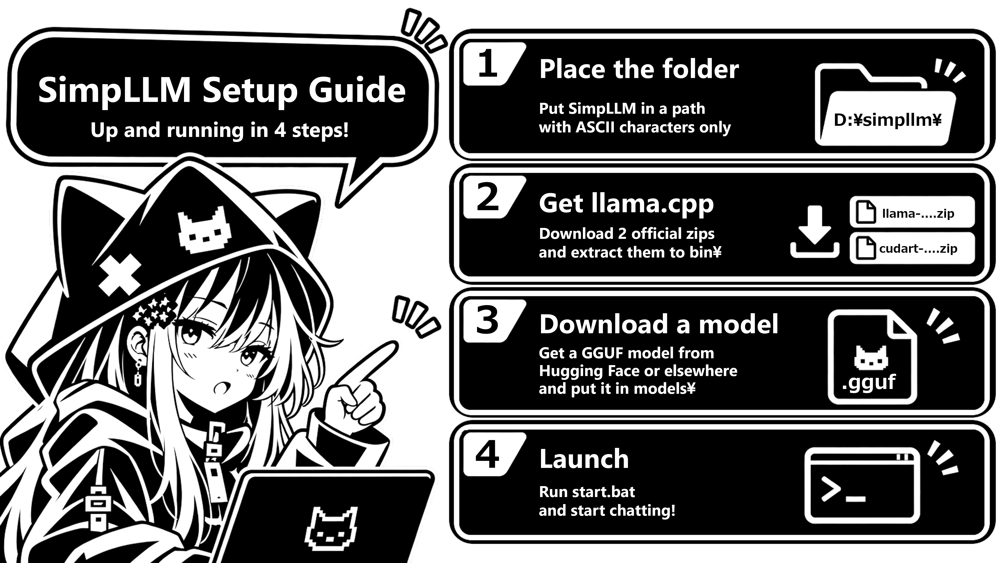

<div align="center">



<p>
  <a href="README.md">日本語</a> ·
  <b>English</b> ·
  <a href="README.de.md">Deutsch</a> ·
  <a href="README.zh-CN.md">简体中文</a> ·
  <a href="README.ko.md">한국어</a>
</p>


<p>
  
  
  
  
  
  
</p>

<p>
  <a href="https://github.com/Retro-Maid/SimpLLM/releases"></a>
  <a href="https://github.com/Retro-Maid/SimpLLM/commits"></a>
  <a href="LICENSE"></a>
  <a href="https://github.com/Retro-Maid/SimpLLM/releases"></a>
  <a href="https://github.com/Retro-Maid/SimpLLM/stargazers"></a>
</p>

<p>
  <a href="#quickstart">Quick start</a> ・
  <a href="#features">What it does</a> ・
  <a href="#compare">Comparison</a> ・
  <a href="#requirements">Requirements</a> ・
  <a href="#troubleshooting">When it does not work</a>
</p>

</div>

<div align="center">

</div>

<a id="quickstart"></a>

## Quick start (faster than making cup noodles)

1. **Get SimpLLM** — download the zip from [Releases](https://github.com/Retro-Maid/SimpLLM/releases/latest) and extract it. Any folder you can write to works, for example `C:\simpllm`
2. **Add llama.cpp** — download these two files from the [official releases](https://github.com/ggml-org/llama.cpp/releases) and put their contents directly into `bin\` (the contents, not the folder)

   ```
   llama-<version>-bin-win-cuda-12.4-x64.zip
   cudart-llama-bin-win-cuda-12.4-x64.zip
   ```

3. **Add a model** — drop any `.gguf` you like into `models\`
4. **Start** — double-click `start.bat`

When the window opens, you can start talking. That is probably quicker than the three minutes your noodles need (downloading the model is a separate matter).

<a id="features"></a>

## What it does

Download the folder. Download llama.cpp. Add a model you like. Double-click `start.bat` and you are up and running.

- **No installation** — there is no installer and nothing is written to the registry. When you no longer need it, delete the folder.
- **No extra software** — no Python, no Node.js, no Docker. It runs on the PowerShell that ships with Windows, plus Chrome or Edge.
- **About 1 MB** — you bring llama.cpp and the models yourself. SimpLLM itself is about 1 MB.
- **One HTML page** — no framework and no external libraries.
- **Starts fast** — the window opens first and the model loads in the background. On the development PC it takes about 0.45 seconds from launch to just before the window opens.
- **Closed means stopped** — closing the window stops the server too. Nothing keeps running.
- **Stays light in long chats** — more chats do not slow it down much. Only the list of chats is read up front; the text of a chat is read when you open it.

The features, in one table:

| | |
|---|---|
| Chat | Regenerate, edit, branch, switch models, save system prompts |
| Attachments | Text files, PDFs, images (images only with a model that has an `mmproj`) |
| Image generation and editing | Available once you add stable-diffusion.cpp and an image model |
| History | Chats, images and settings are saved automatically. Folders, pinning, search, export as JSON or Markdown |
| Advanced features | Local tools, projects, and btw for a quick side question without interrupting the main chat |
| Display languages | Japanese, English, Simplified Chinese, Traditional Chinese, Korean, German |
| Privacy | Chats never leave your PC. The page does not talk to the outside either |

<a id="compare"></a>

## Compared with other chat clients (light! easy! no install!)

Compared using the Windows version of each app as of November 2026 (LM Studio 0.4.28, Ollama 0.40.17).

| | SimpLLM | LM Studio | Ollama |
|---|---|---|---|
| Setup | Put the folder somewhere | Installer | Installer |
| What else you need | llama.cpp (from the official releases, into `bin\`) | Nothing | Nothing |
| Size of the app | About 1 MB | A full application | A full application |
| Operating systems | Windows only | Windows, macOS, Linux | Windows, macOS (Linux: command line only) |
| Getting models | You download them and put them in place | Search Hugging Face and download inside the app | Pick and download inside the app |
| GGUF files you already have | Put them in place and they appear in the list | Import with a command (`lms import`) | Write a Modelfile and import |
| Regenerate, branch, continue | Yes | Yes | No |
| System prompt and sampling settings | Set in the UI | Set in the UI | Not in the UI |
| Load settings (KV cache type and more) | Set in the UI | Set in the UI | Context length only |
| Chat search, folders, export | Yes (JSON, Markdown) | Yes (PDF, Markdown, plain text) | Rename and delete only |
| Document attachments | Text, PDF | Text, PDF, docx (RAG for long documents) | Text, PDF, docx and more |
| Tools | Built in (date and time, calculator, search past chats) | Connect outside tools over MCP | Web search (account required) |
| Image generation and editing | Yes | No | No |
| UI languages | 6 | Many (including Japanese) | English only |
| Network access | None (the UI and browser settings keep it from reaching outside) | Update check at launch, model search and downloads | Regular update checks, cloud features |
| Source code | Open (MIT) | Closed (free for work use) | Open (MIT) |

SimpLLM is for people who want to run the models they already have on Windows, right away, without installing anything and without any network access. Image generation is in the same window. If you want macOS or Linux, want to browse models inside the app, or want to connect outside tools over MCP, LM Studio will suit you better. If you just want the easiest start, use Ollama.

<a id="requirements"></a>

## Requirements

| | |
|---|---|
| OS | Windows 10 (1809 or later) or Windows 11. It does not run on macOS or Linux |
| Browser | Chrome or Edge. Edge comes with Windows |
| GPU | NVIDIA recommended |
| Memory | RAM and VRAM together should be larger than the model file. If there is not enough, the reason is shown at startup |

For llama.cpp, download these two files from the [official releases](https://github.com/ggml-org/llama.cpp/releases) and put them into `bin\`. The version it was tested with is b11669.

```
llama-<version>-bin-win-cuda-12.4-x64.zip
cudart-llama-bin-win-cuda-12.4-x64.zip
```

Some things have not been tried.

- A PC without an NVIDIA GPU. It should run on the CPU, only slower. On the development PC it was checked with CUDA removed, and no further
- AMD and Intel GPUs. The CUDA build does not use them. Putting the Vulkan build (`llama-<version>-bin-win-vulkan-x64.zip`) into `bin\` might work

The display language follows the Windows language at first. You can change it under "General" in Settings.

### Generating and editing images (optional)

Images are made by [stable-diffusion.cpp](https://github.com/leejet/stable-diffusion.cpp), not by llama.cpp. If you do not need images, you can skip this.

1. Download these two files from the [official releases](https://github.com/leejet/stable-diffusion.cpp/releases) and put their contents into `bin\sd\` (not directly into `bin\`). The version it was tested with is master-1031-c6dfa9d

   ```
   sd-master-<version>-bin-win-cuda12-x64.zip
   cudart-sd-bin-win-cu12-x64.zip
   ```

2. Put the image model's main file, text encoder and VAE together into `models\image\<model name>\`. The kinds of files needed are listed in [models/README.md](models/README.md) (Japanese)
3. Use the "Image" button in the input box (`Ctrl+Shift+G`)

On the development PC (RTX 3060, 12 GB VRAM), one 1024×1024 image took about 43 seconds with Chroma Flash. No models are bundled and no download sources are recommended. Which model to use, getting it and checking its license are up to you.

<a id="troubleshooting"></a>

## When it does not work

If it cannot start or cannot load a model, the reason is shown in the window or in a popup. Read that first.

<details>
<summary><b>It does not start, or the model does not load</b></summary>

- Put the contents of the zip directly into `bin\`, not as a folder. Both zips are needed
- Not enough memory? Make the context length smaller under "Launch settings" in Settings (8192, for example). A smaller model also helps
- An old NVIDIA driver will not work. Update it
- The model file is cut off or damaged → download it again
- A new kind of model cannot be read by an old llama.cpp. Replace the contents of `bin\` with a newer version

</details>

<details>
<summary><b>It stopped working after I changed a setting</b></summary>

Press "Reset to defaults" under "Launch settings" in Settings. A setting that keeps the server from starting is rolled back automatically when you apply it.

</details>

<details>
<summary><b>I cannot attach an image</b></summary>

- "This model does not support image input" → put the matching `mmproj*.gguf` in the same folder as the model
- "Image input for chat is off" → turn on "Image input for chat" under "Launch settings" in Settings

</details>

<details>
<summary><b>Generation is slow</b></summary>

Without a GPU it runs on the CPU, and that is slow no matter what. With a GPU, you can tune it under "Advanced" in "Launch settings".

</details>

<details>
<summary><b>Other things</b></summary>

"Neither Chrome nor Edge was found". You can point it at a Chromium-based browser installed elsewhere (Brave works too).

```
start.bat -Browser "<path of the executable>"
```

Port 8080 is taken. Unless you asked for a specific number, it simply uses a free one.

No reason is shown at all. You can look at the raw output of the server.

```
start.bat -ShowServerLog
```

</details>

## Settings

Open them with "Settings" at the bottom left.

| Section | What is in it |
|---|---|
| General | Send with Enter or not, show advanced features or not, display language |
| System prompt | Instructions for the current chat, and saved instructions you use often |
| Models | The model folder, the list of models found, settings per model |
| Launch settings | Image input for chat, context length, speed tuning |
| Generation | Temperature and the other generation parameters |
| Images | State and settings of image generation and editing |
| Shortcuts | The list of keyboard shortcuts. `Ctrl+/` opens it too |
| Data | Import, export, delete everything |

A few notes.

- Tools, btw, projects, multi-select and the token count stay hidden until you turn on "Show advanced features". Only the context usage appears on its own when you get close to the limit
- A blank launch setting means the llama.cpp default. Most PCs run fine with that. The values are kept in `.run\launch.json`. Anything passed as an argument, like `start.bat -Context 8192`, wins
- Blank generation parameters are automatic too: the official recommended values for Qwen models, the llama.cpp defaults for the rest
- The "Image" button appears in the message box only after you add an image engine and a model

## Updating and uninstalling

To update, quit SimpLLM and copy the new files over your current folder. These are not part of a new version, so they stay.

- `history\` … chats, images, settings
- `models\` … your models
- `bin\` … llama.cpp
- `.run\` … launch settings and the model settings you changed in the window

To move to another folder, take `history\`, `models\`, `bin\` and, from `.run\`, the files `launch.json`, `model-dir` and `model-settings.json`.

To update only llama.cpp, replace the contents of `bin\`.

To stop using it, quit and delete the folder. The desktop shortcut (simpllm) is the one thing you have to remove by hand. Nothing is written anywhere else.

## License

[MIT](LICENSE). Use it privately or at work, change it, pass it on. Just keep the copyright notice and the license text.
