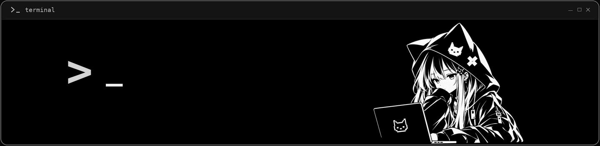
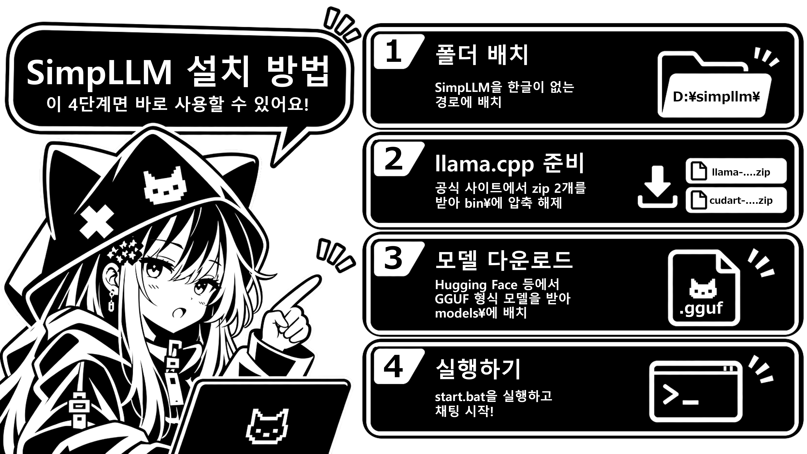

<div align="center">



<p>
  <a href="README.md">日本語</a> ·
  <a href="README.en.md">English</a> ·
  <a href="README.de.md">Deutsch</a> ·
  <a href="README.zh-CN.md">简体中文</a> ·
  <b>한국어</b>
</p>


<p>
  
  
  
  
  
</p>

<p>
  <a href="https://github.com/Retro-Maid/SimpLLM/releases"></a>
  <a href="https://github.com/Retro-Maid/SimpLLM/commits"></a>
  <a href="LICENSE"></a>
  <a href="https://github.com/Retro-Maid/SimpLLM/releases"></a>
  <a href="https://github.com/Retro-Maid/SimpLLM/stargazers"></a>
</p>

<p>
  <a href="#quickstart">빠른 시작</a> ・
  <a href="#features">할 수 있는 것</a> ・
  <a href="#compare">비교</a> ・
  <a href="#requirements">동작 환경</a> ・
  <a href="#troubleshooting">잘 동작하지 않을 때</a>
</p>

</div>

<div align="center">

</div>

<a id="quickstart"></a>

## 빠른 시작 (컵라면 끓이는 것보다 빨라요)

1. **SimpLLM 놓기** — [릴리스](https://github.com/Retro-Maid/SimpLLM/releases/latest)에서 zip을 받아서 풉니다. `C:\simpllm`처럼 쓰기 권한이 있는 곳이면 어디든 됩니다
2. **llama.cpp 넣기** — [공식 릴리스](https://github.com/ggml-org/llama.cpp/releases)에서 아래 두 파일을 받아, 안의 내용을 `bin\` 바로 아래에 넣습니다 (폴더째가 아니라 내용만)

   ```
   llama-<버전>-bin-win-cuda-12.4-x64.zip
   cudart-llama-bin-win-cuda-12.4-x64.zip
   ```

3. **모델 넣기** — 원하는 `.gguf`를 `models\`에 넣습니다
4. **시작** — `start.bat`을 더블클릭

창이 열리면 바로 말을 걸 수 있습니다. 컵라면에 물 붓고 기다리는 3분보다 아마 빠를 거예요 (모델 다운로드 시간은 별개입니다).

<a id="features"></a>

## 할 수 있는 것

폴더를 받는다. llama.cpp를 받는다. 원하는 모델을 넣는다. `start.bat`을 더블클릭하면 바로 쓸 수 있습니다.

- **설치 불필요** — 설치 프로그램이 없습니다. 레지스트리에도 쓰지 않습니다. 필요 없어지면 폴더째 지우면 됩니다.
- **추가 소프트웨어 없음** — Python도 Node.js도 Docker도 깔지 않습니다. Windows에 원래 있는 PowerShell과 Chrome 또는 Edge로 동작합니다.
- **본체는 1MB** — llama.cpp와 모델은 직접 준비합니다. SimpLLM 자체는 1MB 정도입니다.
- **화면은 HTML 한 장** — 프레임워크도 외부 라이브러리도 쓰지 않습니다.
- **시작이 빠름** — 창이 먼저 열리고, 모델은 뒤에서 불러옵니다. 개발용 PC에서는 시작부터 창을 열기 직전까지 0.45초 정도.
- **닫으면 끝** — 창을 닫으면 서버도 멈춥니다. 뒤에 아무것도 남지 않습니다.
- **대화가 길어져도 가벼움** — 대화가 늘어도 잘 느려지지 않습니다. 목록만 먼저 읽고, 본문은 연 대화만 읽습니다.

기능은 아래 표와 같습니다.

| | |
|---|---|
| 채팅 | 다시 생성, 편집, 분기, 모델 전환, 시스템 프롬프트 저장 |
| 첨부 | 텍스트, PDF, 이미지 (이미지는 `mmproj`가 있는 모델만) |
| 이미지 생성·편집 | stable-diffusion.cpp와 이미지 모델을 넣으면 쓸 수 있습니다 |
| 기록 | 채팅·이미지·설정을 자동으로 저장. 폴더, 고정, 검색, JSON과 Markdown 내보내기 |
| 고급 기능 | 로컬 도구, 프로젝트, 본 채팅을 멈추지 않고 물어보는 btw |
| 표시 언어 | 일본어, 영어, 중국어 간체, 중국어 번체, 한국어, 독일어 |
| 프라이버시 | 대화는 PC 밖으로 나가지 않습니다. 화면도 외부와 통신하지 않습니다 |

<a id="compare"></a>

## 다른 채팅 클라이언트와 비교 (가볍다! 간편하다! 설치도 필요 없어요!)

2026년 11월 기준, 각 앱의 Windows 버전 화면으로 비교했습니다 (LM Studio 0.4.28, Ollama 0.40.17).

| | SimpLLM | LM Studio | Ollama |
|---|---|---|---|
| 도입 | 폴더를 놓기만 하면 됨 | 설치 프로그램 | 설치 프로그램 |
| 따로 준비할 것 | llama.cpp (공식에서 받아 `bin\`에 넣기) | 없음 | 없음 |
| 본체 크기 | 약 1MB | 앱 일체 | 앱 일체 |
| 지원 OS | Windows만 | Windows, macOS, Linux | Windows, macOS (Linux는 명령줄만) |
| 모델 구하기 | 직접 준비해서 넣기 | 앱 안에서 Hugging Face를 검색해 받기 | 앱 안에서 골라 받기 |
| 가지고 있는 GGUF | 넣기만 하면 목록에 나옴 | 명령 (`lms import`)으로 가져오기 | Modelfile을 써서 가져오기 |
| 다시 생성, 분기, 이어서 생성 | 가능 | 가능 | 불가 |
| 시스템 프롬프트, 생성 파라미터 | 화면에서 설정 | 화면에서 설정 | 화면에서는 설정 불가 |
| 불러오기 설정 (KV 캐시 형식 등) | 화면에서 설정 | 화면에서 설정 | 컨텍스트 길이만 |
| 대화 검색, 폴더, 내보내기 | 가능 (JSON, Markdown) | 가능 (PDF, Markdown, 텍스트) | 이름 변경과 삭제만 |
| 문서 첨부 | 텍스트, PDF | 텍스트, PDF, docx (긴 문서는 RAG) | 텍스트, PDF, docx 등 |
| 도구 | 내장 (날짜와 시간, 계산, 지난 대화 검색) | MCP로 외부 도구 연결 | 웹 검색 (계정 필요) |
| 이미지 생성과 편집 | 가능 | 불가 | 불가 |
| 표시 언어 | 6개 언어 | 여러 언어 (일본어 포함) | 영어만 |
| 외부 통신 | 없음 (화면과 브라우저 설정으로 외부에 나갈 수 없음) | 시작할 때 업데이트 확인, 모델 검색과 다운로드 | 정기적인 업데이트 확인, 클라우드 기능 |
| 소스 코드 | 공개 (MIT) | 비공개 (업무용으로도 무료) | 공개 (MIT) |

SimpLLM은 Windows에서, 아무것도 설치하지 않고, 통신도 하지 않고, 가지고 있는 모델을 바로 돌리고 싶은 사람을 위한 도구입니다. 이미지 생성까지 한 화면에서 할 수 있습니다. Mac이나 Linux에서 쓰고 싶거나, 앱 안에서 모델을 찾고 싶거나, MCP로 외부 도구를 연결하고 싶다면 LM Studio가 더 맞습니다. 무엇보다 간편하게 시작하고 싶다면 Ollama입니다.

<a id="requirements"></a>

## 동작 환경

| | |
|---|---|
| OS | Windows 10 (1809 이상) 또는 Windows 11. Mac과 Linux에서는 동작하지 않습니다 |
| 브라우저 | Chrome 또는 Edge. Edge는 Windows에 처음부터 들어 있습니다 |
| GPU | NVIDIA 권장 |
| 메모리 | RAM과 VRAM을 합쳐 모델 파일보다 커야 합니다. 부족하면 시작할 때 이유가 표시됩니다 |

llama.cpp는 [공식 릴리스](https://github.com/ggml-org/llama.cpp/releases)에서 아래 두 파일을 받아 `bin\`에 넣습니다. 동작을 확인한 버전은 b11669입니다.

```
llama-<버전>-bin-win-cuda-12.4-x64.zip
cudart-llama-bin-win-cuda-12.4-x64.zip
```

시험해 보지 못한 것도 있습니다.

- NVIDIA GPU가 없는 PC. CPU로 동작할 테지만 느려집니다. 개발용 PC에서 CUDA를 뺀 상태까지만 확인했습니다
- AMD나 Intel의 GPU. CUDA 버전에서는 쓰이지 않습니다. Vulkan 버전(`llama-<버전>-bin-win-vulkan-x64.zip`)을 `bin\`에 넣으면 될 수도 있습니다

표시 언어는 처음에는 Windows의 언어를 따릅니다. 설정의 "일반"에서 바꿀 수 있습니다.

<a id="troubleshooting"></a>

## 잘 동작하지 않을 때

시작되지 않거나 모델을 불러오지 못할 때는, 이유가 화면이나 팝업에 표시됩니다. 먼저 그것을 읽어 주세요.

<details>
<summary><b>시작되지 않는다·모델을 불러오지 못한다</b></summary>

- zip의 내용은 폴더째가 아니라 `bin\` 바로 아래에 넣습니다. zip은 두 개 모두 넣습니다
- 메모리가 부족하면 설정의 "시작 설정"에서 컨텍스트 길이를 줄입니다 (8192 등). 더 작은 모델로 바꾸는 것도 방법입니다
- NVIDIA 드라이버가 오래되면 동작하지 않습니다. 업데이트하세요
- 모델 파일이 중간에 끊겼거나 손상됨 → 다시 다운로드
- 새로운 종류의 모델은 오래된 llama.cpp로 읽을 수 없습니다. `bin\`의 내용을 새 버전으로 바꿉니다

</details>

<details>
<summary><b>설정을 바꿨더니 동작하지 않는다</b></summary>

설정의 "시작 설정"에서 "기본값으로 되돌리기"를 누르면 원래대로 돌아갑니다. 서버가 시작되지 않게 되는 설정은 적용하는 시점에 자동으로 되돌립니다.

</details>

<details>
<summary><b>이미지를 첨부할 수 없다</b></summary>

- "이 모델은 이미지 입력을 지원하지 않습니다"라고 나온다 → 이름이 맞는 `mmproj*.gguf`를 모델과 같은 폴더에 둡니다
- "채팅 이미지 입력이 꺼져 있습니다"라고 나온다 → 설정의 "시작 설정"에서 "채팅 이미지 입력"을 켭니다

</details>

<details>
<summary><b>생성이 느리다</b></summary>

GPU가 없는 PC에서는 CPU로 동작하므로 어쩔 수 없이 느립니다. GPU가 있다면 설정의 "시작 설정"의 "고급"에서 조정할 수 있습니다.

</details>

<details>
<summary><b>그 밖에</b></summary>

Chrome도 Edge도 찾을 수 없다고 나올 때. 다른 곳에 설치한 Chrome 계열 브라우저(Brave 등도 가능)를 지정할 수 있습니다.

```
start.bat -Browser "<실행 파일 경로>"
```

포트 8080이 사용 중일 때. 번호를 지정하지 않았다면 비어 있는 번호를 알아서 씁니다.

이유가 아무것도 나오지 않을 때. 서버의 출력을 그대로 볼 수 있습니다.

```
start.bat -ShowServerLog
```

</details>

## 설정 화면

왼쪽 아래의 "설정"에서 엽니다.

| 항목 | 내용 |
|---|---|
| 일반 | Enter로 보낼지, 고급 기능을 표시할지, 표시 언어 |
| 시스템 프롬프트 | 지금 채팅에 대한 지시와, 자주 쓰는 지시의 저장 |
| 모델 | 모델을 두는 폴더, 찾은 모델 목록, 모델별 설정 |
| 시작 설정 | 채팅 이미지 입력, 컨텍스트 길이, 속도 조정 |
| 생성 | 온도 등의 생성 파라미터 |
| 이미지 | 이미지 생성·편집의 상태와 설정 |
| 단축키 | 키보드 단축키 목록. `Ctrl+/`로도 열립니다 |
| 데이터 | 채팅 가져오기, 내보내기, 모두 삭제 |

몇 가지 보충입니다.

- 도구, btw, 프로젝트, 여러 개 선택, 그리고 토큰 수 표시는 "고급 기능 표시"를 켜기 전에는 나오지 않습니다. 컨텍스트 사용량만은 한도에 가까워지면 꺼져 있어도 나옵니다
- 시작 설정은 비워 두면 llama.cpp의 기본값 그대로입니다. 대부분의 PC는 그대로 동작합니다. 값은 `.run\launch.json`에 남습니다. `start.bat -Context 8192`처럼 인수로 넘긴 것이 있으면 그쪽이 우선합니다
- 생성 파라미터도 비워 두면 자동입니다. Qwen 계열 모델은 공식 권장값, 그 밖에는 llama.cpp의 기본값이 됩니다
- "이미지" 버튼은 이미지 엔진과 모델을 넣었을 때만 입력란에 나옵니다

## 업데이트·제거

새 버전으로 바꿀 때는 SimpLLM을 종료한 다음, 새 파일을 지금 폴더에 덮어씁니다. 아래 것들은 새 버전의 파일에 들어 있지 않으므로 사라지지 않습니다.

- `history\` … 채팅, 이미지, 설정
- `models\` … 넣어 둔 모델
- `bin\` … llama.cpp
- `.run\` … 시작 설정과, 화면에서 고친 모델 설정

다른 폴더로 옮기려면 `history\`·`models\`·`bin\`과, `.run\` 안의 `launch.json`·`model-dir`·`model-settings.json`을 가져갑니다.

llama.cpp만 새로 하고 싶을 때는 `bin\`의 내용을 바꿔 넣습니다.

그만 쓸 때는 종료하고 폴더째 삭제. 바탕 화면의 바로 가기(simpllm)만은 직접 지워 주세요. 다른 곳에는 아무것도 쓰지 않았습니다.

## 라이선스

[MIT](LICENSE)입니다. 개인이든 업무든, 개조도 재배포도 자유롭게 하세요. 저작권 표시와 라이선스 문구만 남겨 주세요.
