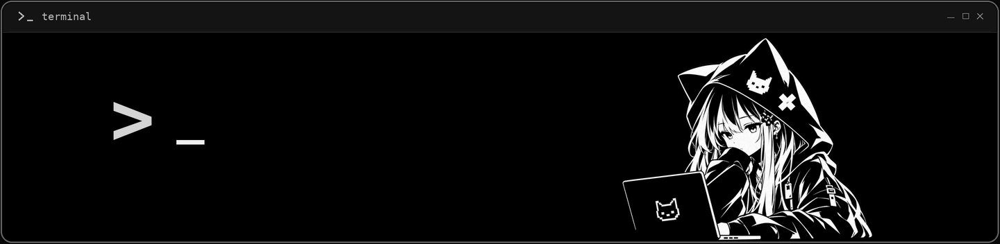
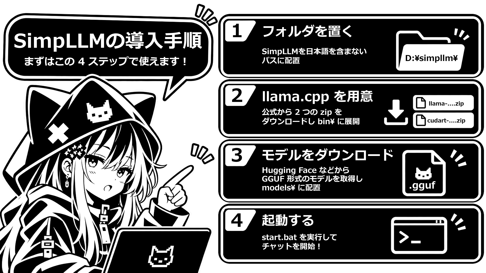

<div align="center">



<p>
  <b>日本語</b> ·
  <a href="README.en.md">English</a> ·
  <a href="README.de.md">Deutsch</a> ·
  <a href="README.zh-CN.md">简体中文</a> ·
  <a href="README.ko.md">한국어</a>
</p>


<p>
  
  
  
  
  
</p>

<p>
  <a href="https://github.com/Retro-Maid/SimpLLM/releases"></a>
  <a href="https://github.com/Retro-Maid/SimpLLM/commits"></a>
  <a href="LICENSE"></a>
  <a href="https://github.com/Retro-Maid/SimpLLM/releases"></a>
  <a href="https://github.com/Retro-Maid/SimpLLM/stargazers"></a>
</p>

<p>
  <a href="#quickstart">クイックスタート</a> ・
  <a href="#features">できること</a> ・
  <a href="#compare">比較</a> ・
  <a href="#requirements">動作環境</a> ・
  <a href="#troubleshooting">うまく動かないとき</a>
</p>

</div>

<div align="center">

</div>

<a id="quickstart"></a>

## クイックスタート（カップヌードル作るより早いよ）

1. **SimpLLM を置く** — [リリース](https://github.com/Retro-Maid/SimpLLM/releases/latest) から zip を落として展開。場所は `C:\simpllm` のような書き込めるところならどこでも
2. **llama.cpp を入れる** — [公式のリリース](https://github.com/ggml-org/llama.cpp/releases) から次の 2 つを落として、中身を `bin\` の直下へ（フォルダごとではなく、中身だけ）

   ```
   llama-<版>-bin-win-cuda-12.4-x64.zip
   cudart-llama-bin-win-cuda-12.4-x64.zip
   ```

3. **モデルを置く** — 好きな `.gguf` を `models\` に入れる
4. **起動** — `start.bat` をダブルクリック

ウィンドウが開いたら、もう話しかけられます。お湯を注いで待つ 3 分より、たぶん早いです（モデルのダウンロードは別腹）。

<a id="features"></a>

## できること

フォルダをダウンロード。llama.cppをダウンロードしてくる。好きなモデルを入れる。 `start.bat` をダブルクリックですぐ使えます。

- **インストール不要** — インストーラーはありません。レジストリにも書きません。要らなくなったらフォルダごと消してください。
- **追加のソフトなし** — Python も Node.js も Docker も入れません。Windows に元からある PowerShell と、Chrome か Edge で動きます。
- **本体は 1MB** — llama.cpp とモデルは自分で用意します。SimpLLM そのものは 1MB ほどです。
- **画面は HTML 1 枚** — フレームワークも外部のライブラリも使っていません。
- **起動が速い** — ウィンドウが先に開いて、モデルの読み込みは後ろで進みます。開発用の PC だと、起動からウィンドウを開く直前まで 0.45 秒くらい。
- **閉じたら終わり** — ウィンドウを閉じればサーバーも止まります。裏に何も残りません。
- **長い会話でも軽い** — 会話が増えても重くなりにくいです。履歴は一覧だけ先に読み、本文は開いた会話の分だけ読みます。

機能は以下の表の通り。

| | |
|---|---|
| チャット | 再生成・編集・分岐、モデルの切り替え、システムプロンプトの登録 |
| 添付 | テキスト、PDF、画像（画像は `mmproj` のあるモデルだけ） |
| 画像の生成・編集 | stable-diffusion.cpp と画像モデルを置けば使えます |
| 履歴 | 会話・画像・設定を自動で保存。フォルダ分け、ピン留め、検索、JSON と Markdown での書き出し |
| 詳細機能 | ローカルツール、プロジェクト、本題を止めずに聞ける btw |
| 表示言語 | 日本語、英語、簡体字中国語、繁体字中国語、韓国語、ドイツ語 |
| プライバシー | 会話は PC の外に出ません。画面も外部と通信しません |

<a id="compare"></a>

## ほかのチャットクライアントとの比較（軽い！お手軽！インストールもいらないよ！）

2026 年 11 月時点の、各アプリの Windows 版の画面で比べています（LM Studio 0.4.28、Ollama 0.40.17）。

| | SimpLLM | LM Studio | Ollama |
|---|---|---|---|
| 導入 | フォルダを置くだけ | インストーラー | インストーラー |
| 別に用意するもの | llama.cpp（公式から入手して `bin\` に入れる） | なし | なし |
| 本体の大きさ | 約 1MB | アプリ一式 | アプリ一式 |
| 対応 OS | Windows のみ | Windows・macOS・Linux | Windows・macOS（Linux はコマンドのみ） |
| モデルの入手 | 自分で用意して置く | アプリの中で Hugging Face を検索して入手 | アプリの中で選んで入手 |
| 手持ちの GGUF | 置くだけで一覧に出る | コマンド（`lms import`）で取り込む | Modelfile を書いて取り込む |
| 再生成・分岐・続きの生成 | できる | できる | できない |
| システムプロンプト・生成パラメータ | 画面で設定できる | 画面で設定できる | 画面では設定できない |
| 読み込みの設定（KV キャッシュの型など） | 画面で設定できる | 画面で設定できる | コンテキスト長だけ |
| 会話の検索・フォルダ・書き出し | できる（JSON・Markdown） | できる（PDF・Markdown・テキスト） | 名前の変更と削除だけ |
| 文書の添付 | テキスト・PDF | テキスト・PDF・docx（長い文書は RAG） | テキスト・PDF・docx など |
| ツール | 内蔵（日時・計算・過去の会話の検索） | MCP で外部のツールをつなぐ | Web 検索（アカウントが必要） |
| 画像の生成・編集 | できる | できない | できない |
| 表示言語 | 6 言語 | 多言語（日本語あり） | 英語のみ |
| 外部との通信 | しない（画面とブラウザの設定で外へ出られない） | 起動時の更新確認、モデルの検索とダウンロード | 定期的な更新確認、クラウドの機能 |
| ソースコード | 公開（MIT） | 非公開（仕事でも無料で使える） | 公開（MIT） |

SimpLLM は、Windows で、何も入れずに、通信もさせずに、手持ちのモデルをすぐ動かしたい人向けです。画像の生成までひとつの画面で済みます。Mac や Linux で使いたい、モデルをアプリの中で探したい、MCP で外部のツールをつなぎたい、という場合は LM Studio のほうが合います。とにかく手軽に始めたいなら Ollama です。

<a id="requirements"></a>

## 動作環境

| | |
|---|---|
| OS | Windows 10（1809 以降）か Windows 11。Mac と Linux では動きません |
| ブラウザ | Chrome か Edge。Edge は Windows に最初から入っています |
| GPU | NVIDIA 製を推奨 |
| メモリ | RAM と VRAM を合わせて、モデルのファイルより多いこと。足りないときは起動時に理由が出ます |

llama.cpp は [公式のリリース](https://github.com/ggml-org/llama.cpp/releases) から、次の 2 つを落として `bin\` に入れます。動作を確かめた版は b11669 です。

```
llama-<版>-bin-win-cuda-12.4-x64.zip
cudart-llama-bin-win-cuda-12.4-x64.zip
```

試せていないこともあります。

- NVIDIA の GPU がない PC。CPU で動くはずですが、遅くなります。開発用の PC で CUDA を外した状態までは確かめました
- AMD や Intel の GPU。CUDA 版では使われません。Vulkan 版（`llama-<版>-bin-win-vulkan-x64.zip`）を `bin\` に入れれば動くかもしれません

表示言語は、最初は Windows の言語に合わせます。設定の「一般」で変えられます。

<a id="troubleshooting"></a>

## うまく動かないとき

起動できない、モデルを読めない、というときは、理由が画面かポップアップに出ます。まずそれを読んでください。

<details>
<summary><b>起動しない・モデルを読み込めない</b></summary>

- zip の中身は、フォルダごとではなく `bin\` の直下に入れます。zip は 2 つとも入れます
- メモリが足りないなら、設定の「起動設定」でコンテキスト長を小さくします（8192 など）。小さいモデルに替えるのも手です
- NVIDIA のドライバーが古いと動きません。更新してください
- モデルのファイルが途中で切れている、壊れている → ダウンロードし直し
- 新しい種類のモデルは、古い llama.cpp では読めません。`bin\` の中身を新しい版にします

</details>

<details>
<summary><b>設定を変えたら動かなくなった</b></summary>

設定の「起動設定」で「既定に戻す」を押せば元に戻ります。サーバーが起動しなくなるような設定は、適用した時点で自動的に元へ戻します。

</details>

<details>
<summary><b>画像を添付できない</b></summary>

- 「このモデルは画像入力に対応していません」と出る → モデルと同じフォルダに、名前の合う `mmproj*.gguf` を置きます
- 「チャットへの画像入力はオフです」と出る → 設定の「起動設定」で「チャットへの画像入力」をオンにします

</details>

<details>
<summary><b>生成が遅い</b></summary>

GPU がない PC では CPU で動くので、どうしても遅くなります。GPU があるなら、設定の「起動設定」の「詳細」で調整できます。

</details>

<details>
<summary><b>そのほか</b></summary>

Chrome も Edge も見つからない、と出るとき。別の場所に入れた Chrome 系のブラウザ（Brave なども可）を指定できます。

```
start.bat -Browser "<実行ファイルのパス>"
```

ポート 8080 がふさがっているとき。番号を指定していなければ、空いている番号を勝手に使います。

理由が何も出ないとき。サーバーの出力をそのまま見られます。

```
start.bat -ShowServerLog
```

</details>

## 設定画面

左下の「設定」から開きます。

| 項目 | 内容 |
|---|---|
| 一般 | Enter で送信するか、詳細機能を出すか、表示言語 |
| システムプロンプト | 今のチャットへの指示と、よく使う指示の登録 |
| モデル | モデルを置くフォルダ、見つけたモデルの一覧、モデルごとの設定 |
| 起動設定 | チャットへの画像入力、コンテキスト長、速度の調整 |
| 生成 | 温度などの生成パラメータ |
| 画像 | 画像の生成・編集の状態と設定 |
| ショートカット | キーボードショートカットの一覧。`Ctrl+/` でも開きます |
| データ | 会話の読み込み、書き出し、全削除 |

いくつか補足です。

- ツール、btw、プロジェクト、複数選択、それとトークン数の表示は、「詳細機能を表示」をオンにするまで出ません。コンテキストの使用量だけは、上限が近づくとオフでも出ます
- 起動設定は、空欄なら llama.cpp の標準のままです。たいていの PC はそれで動きます。値は `.run\launch.json` に残ります。`start.bat -Context 8192` のように引数で渡したものがあれば、そちらが勝ちます
- 生成のパラメータも空欄が自動です。Qwen 系のモデルは公式の推奨値、ほかは llama.cpp の標準になります
- 「画像」ボタンは、画像エンジンとモデルを置いたときだけ入力欄に出ます

## 更新・アンインストール

新しい版にするときは、SimpLLM を終了してから、新しいファイルを今のフォルダに上書きコピーします。次のものは新しい版のファイルに入っていないので、消えません。

- `history\` … 会話、画像、設定
- `models\` … 置いたモデル
- `bin\` … llama.cpp
- `.run\` … 起動設定と、画面で直したモデルの設定

別のフォルダに入れ直すなら、`history\`・`models\`・`bin\` と、`.run\` の中の `launch.json`・`model-dir`・`model-settings.json` を持っていきます。

llama.cpp だけ新しくしたいときは、`bin\` の中身を入れ替えます。

やめるときは、終了してフォルダごと削除。デスクトップのショートカット（simpllm）だけは手で消してください。ほかの場所には何も書いていません。

## ライセンス

[MIT](LICENSE) です。個人でも仕事でも、改造も再配布も自由にどうぞ。著作権の表示とライセンスの文面だけ残してください。

llama.cpp や各モデルは同梱していません。それぞれのライセンスに従ってください。
