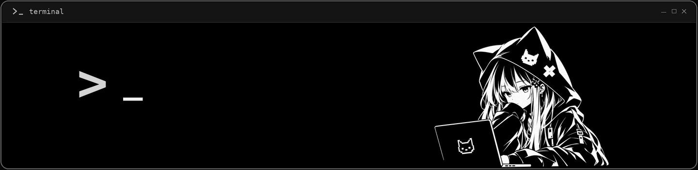
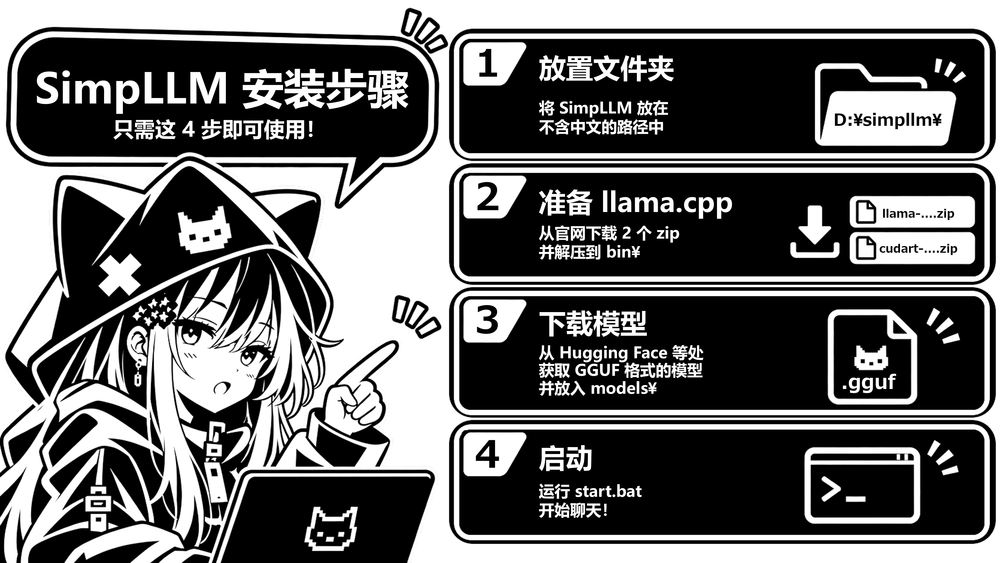

<div align="center">



<p>
  <a href="README.md">日本語</a> ·
  <a href="README.en.md">English</a> ·
  <a href="README.de.md">Deutsch</a> ·
  <b>简体中文</b> ·
  <a href="README.ko.md">한국어</a>
</p>


<p>
  
  
  
  
  
</p>

<p>
  <a href="https://github.com/Retro-Maid/SimpLLM/releases"></a>
  <a href="https://github.com/Retro-Maid/SimpLLM/commits"></a>
  <a href="LICENSE"></a>
  <a href="https://github.com/Retro-Maid/SimpLLM/releases"></a>
  <a href="https://github.com/Retro-Maid/SimpLLM/stargazers"></a>
</p>

<p>
  <a href="#quickstart">快速开始</a> ・
  <a href="#features">能做什么</a> ・
  <a href="#compare">比较</a> ・
  <a href="#requirements">运行环境</a> ・
  <a href="#troubleshooting">运行不正常时</a>
</p>

</div>

<div align="center">

</div>

<a id="quickstart"></a>

## 快速开始（比泡一碗方便面还快）

1. **放好 SimpLLM** — 从[发布页](https://github.com/Retro-Maid/SimpLLM/releases/latest)下载 zip 并解压。放在 `C:\simpllm` 这样有写入权限的地方即可
2. **放入 llama.cpp** — 从[官方发布页](https://github.com/ggml-org/llama.cpp/releases)下载下面两个文件，把里面的内容直接放到 `bin\` 下（不是整个文件夹，只放里面的内容）

   ```
   llama-<版本>-bin-win-cuda-12.4-x64.zip
   cudart-llama-bin-win-cuda-12.4-x64.zip
   ```

3. **放入模型** — 把喜欢的 `.gguf` 放进 `models\`
4. **启动** — 双击 `start.bat`

窗口一打开就可以开始对话。大概比等泡面的 3 分钟还快（下载模型的时间另算）。

<a id="features"></a>

## 能做什么

下载文件夹。下载 llama.cpp。放入喜欢的模型。双击 `start.bat` 就能马上使用。

- **无需安装** — 没有安装程序，也不写注册表。不用了就把文件夹整个删掉。
- **不需要额外的软件** — 不用装 Python、Node.js、Docker。靠 Windows 自带的 PowerShell 和 Chrome 或 Edge 就能运行。
- **本体只有 1MB** — llama.cpp 和模型需要自己准备。SimpLLM 本身大约 1MB。
- **界面只有一个 HTML** — 没有用框架，也没有用外部库。
- **启动快** — 先打开窗口，模型在后台加载。在开发用的电脑上，从启动到打开窗口之前大约 0.45 秒。
- **关了就结束** — 关闭窗口，服务器也一起停止。后台不留任何东西。
- **对话再多也不卡** — 对话变多也不容易变慢。先只读取列表，正文只在打开对话时读取。

功能如下表。

| | |
|---|---|
| 对话 | 重新生成、编辑、分支、切换模型、保存系统提示词 |
| 附件 | 文本、PDF、图片（图片仅限带 `mmproj` 的模型） |
| 图片的生成与编辑 | 放入 stable-diffusion.cpp 和图像模型后即可使用 |
| 历史记录 | 自动保存对话、图片和设置。支持文件夹、置顶、搜索，以及导出为 JSON 和 Markdown |
| 高级功能 | 本地工具、项目，以及不打断主对话就能提问的 btw |
| 显示语言 | 日语、英语、简体中文、繁体中文、韩语、德语 |
| 隐私 | 对话不会离开你的电脑。界面也不与外部通信 |

<a id="compare"></a>

## 与其他聊天客户端的比较（轻！省事！不用安装！）

| | SimpLLM | LM Studio | Ollama | Open WebUI | TextGen（原 text-generation-webui） |
|---|---|---|---|---|---|
| 安装方式 | 放好文件夹即可 | 安装程序 | 安装程序 | Docker 或 Python | 解压即用的版本（约 700MB），或安装整套 Python 的版本（约 10GB） |
| 另需准备 | llama.cpp（从官方获取，放入 `bin\`） | 无 | 无 | 推理软件（如 Ollama） | 无 |
| 本体大小 | 约 1MB | 一整套应用 | 一整套应用 | 容器或整套 Python 环境 | 同上 |
| 支持的系统 | 仅 Windows | Windows、macOS、Linux | Windows、macOS、Linux | Windows、macOS、Linux | Windows、macOS、Linux |
| 获取模型 | 自己准备并放好 | 在应用内搜索并下载 | 用命令下载 | 取决于所连接的软件 | 自己准备，或在界面中下载 |
| 多人使用 | 不支持（一台电脑、一个人用） | 不支持 | 不支持 | 支持（有账号管理） | 不支持 |

适合想在 Windows 上、什么都不装、马上跑起手头模型的人。如果想在 Mac 或 Linux 上用、想在应用内找模型、想几个人共用，其他软件更合适。

<a id="requirements"></a>

## 运行环境

| | |
|---|---|
| 系统 | Windows 10（1809 及以上）或 Windows 11。不支持 Mac 和 Linux |
| 浏览器 | Chrome 或 Edge。Edge 是 Windows 自带的 |
| GPU | 推荐 NVIDIA |
| 内存 | RAM 与 VRAM 之和要大于模型文件。不够时，启动时会显示原因 |

llama.cpp 请从[官方发布页](https://github.com/ggml-org/llama.cpp/releases)下载下面两个文件，放入 `bin\`。已确认可用的版本是 b11669。

```
llama-<版本>-bin-win-cuda-12.4-x64.zip
cudart-llama-bin-win-cuda-12.4-x64.zip
```

也有没试过的情况。

- 没有 NVIDIA GPU 的电脑。应该能用 CPU 运行，只是会慢。在开发用的电脑上只验证到去掉 CUDA 的状态
- AMD 和 Intel 的 GPU。CUDA 版不会用到它们。把 Vulkan 版（`llama-<版本>-bin-win-vulkan-x64.zip`）放入 `bin\` 也许能用

显示语言一开始跟随 Windows 的语言。可以在设置的“常规”中更改。

<a id="troubleshooting"></a>

## 运行不正常时

无法启动、无法加载模型时，原因会显示在界面或弹窗里。请先看那里。

<details>
<summary><b>无法启动、无法加载模型</b></summary>

- zip 里的内容要直接放到 `bin\` 下，不要连文件夹一起放。两个 zip 都要放
- 内存不够的话，在设置的“启动设置”中把上下文长度调小（比如 8192）。换个小一点的模型也行
- NVIDIA 驱动太旧会无法运行，请更新
- 模型文件不完整或已损坏 → 重新下载
- 新类型的模型，旧的 llama.cpp 读不了。把 `bin\` 里的内容换成新版本

</details>

<details>
<summary><b>改了设置之后不能用了</b></summary>

在设置的“启动设置”中点“恢复默认”即可还原。会导致服务器无法启动的设置，在应用时就会自动恢复原状。

</details>

<details>
<summary><b>无法添加图片</b></summary>

- 显示“此模型不支持图片输入” → 把名称对应的 `mmproj*.gguf` 放在模型所在的文件夹中
- 显示“对话的图片输入已关闭” → 在设置的“启动设置”中开启“对话的图片输入”

</details>

<details>
<summary><b>生成很慢</b></summary>

没有 GPU 的电脑用 CPU 运行，慢是免不了的。有 GPU 的话，可以在设置的“启动设置”的“高级”中调整。

</details>

<details>
<summary><b>其他</b></summary>

提示找不到 Chrome 和 Edge 时，可以指定装在别处的 Chrome 系浏览器（Brave 等也可以）。

```
start.bat -Browser "<可执行文件的路径>"
```

端口 8080 被占用时，只要没有指定端口号，就会自动使用空闲的端口。

什么原因都没显示时，可以直接查看服务器的输出。

```
start.bat -ShowServerLog
```

</details>

## 设置界面

从左下角的“设置”打开。

| 项目 | 内容 |
|---|---|
| 常规 | 是否用 Enter 发送、是否显示高级功能、显示语言 |
| 系统提示词 | 给当前对话的指令，以及常用指令的保存 |
| 模型 | 放模型的文件夹、找到的模型列表、每个模型的设置 |
| 启动设置 | 对话的图片输入、上下文长度、速度调整 |
| 生成 | 温度等生成参数 |
| 图片 | 图片生成与编辑的状态和设置 |
| 快捷键 | 键盘快捷键列表。按 `Ctrl+/` 也能打开 |
| 数据 | 对话的导入、导出、全部删除 |

补充几点。

- 工具、btw、项目、多选，以及 token 数的显示，在开启“显示高级功能”之前不会出现。只有上下文用量，在接近上限时即使关闭也会显示
- 启动设置留空就是 llama.cpp 的默认值，大多数电脑这样就能用。数值保存在 `.run\launch.json`。如果用参数传入（如 `start.bat -Context 8192`），以参数为准
- 生成参数留空也是自动：Qwen 系模型用官方推荐值，其他用 llama.cpp 的默认值
- “图片”按钮只在放好图像引擎和模型之后才会出现在输入框

## 更新与卸载

升级时，先退出 SimpLLM，再把新文件覆盖复制到现在的文件夹。下面这些不包含在新版本的文件里，所以不会丢。

- `history\` … 对话、图片、设置
- `models\` … 放入的模型
- `bin\` … llama.cpp
- `.run\` … 启动设置，以及在界面中改过的模型设置

要换到别的文件夹，把 `history\`、`models\`、`bin\`，以及 `.run\` 里的 `launch.json`、`model-dir`、`model-settings.json` 带过去。

只想更新 llama.cpp 时，替换 `bin\` 里的内容。

不用了的话，退出后把文件夹整个删除。只有桌面的快捷方式（simpllm）需要手动删除。别的地方什么都没写。

## 许可证

[MIT](LICENSE)。个人用、工作用、修改、再分发都可以。只要保留版权声明和许可证文本。
